  

<a href="https://www.linkedin.com/in/YOUR-LINKEDIN"><b>LinkedIn</b></a> &nbsp;·&nbsp;
<a href="mailto:YOUR-EMAIL@example.com"><b>Email</b></a> &nbsp;·&nbsp;
<a href="https://YOUR-PORTFOLIO.com"><b>Portfolio</b></a>

 

## About

I'm a software engineering student in Pune who likes building products end to end: a clean React interface, a dependable API behind it, and a machine learning model when the problem actually calls for one.

Right now I'm building AI-integrated web apps and going deeper into LLMs, retrieval-augmented generation and system design. I'm open to **full-time SDE / AI Engineer roles** and **freelance projects**, remote or in Pune.

 

## Selected Work

<table>
  <tr>
    <td width="26%" valign="top"><b>Medical Clinic</b> Healthcare website</td>
    <td valign="top">Responsive clinic website with online appointment booking, doctor profiles and a clear services section. <code>HTML</code> · <code>CSS</code> · <code>JavaScript</code></td>
    <td width="14%" align="right" valign="top"><a href="https://github.com/Hitarth-Saparia/medical-clinic-website-template">Repository →</a></td>
  </tr>
  <tr>
    <td valign="top"><b>JudgeAI</b> AI evaluation tool</td>
    <td valign="top">AI-powered judging assistant that evaluates submissions and returns structured, explainable feedback. <code>Python</code> · <code>FastAPI</code> · <code>React</code></td>
    <td align="right" valign="top"><a href="https://github.com/Hitarth-Saparia/JudgeAI">Repository →</a></td>
  </tr>
  <tr>
    <td valign="top"><b>Warehouse Optimizer</b> Optimization project</td>
    <td valign="top">Tool that improves warehouse layout and space usage to reduce waste and speed up operations. <code>Python</code> · <code>Pandas</code> · <code>NumPy</code></td>
    <td align="right" valign="top"><a href="https://github.com/Hitarth-Saparia/warehouse-optimizer">Repository →</a></td>
  </tr>
</table>

 

## Toolkit

<table>
  <tr>
    <td width="22%"><b>Frontend</b></td>
    <td>React · Next.js · TypeScript · JavaScript · Tailwind CSS · Vite · HTML · CSS</td>
  </tr>
  <tr>
    <td><b>Backend</b></td>
    <td>Node.js · Express · Python · FastAPI</td>
  </tr>
  <tr>
    <td><b>AI / Data</b></td>
    <td>PyTorch · TensorFlow · scikit-learn · Pandas · NumPy · Jupyter</td>
  </tr>
  <tr>
    <td><b>Data & DevOps</b></td>
    <td>MongoDB · PostgreSQL · MySQL · Docker · Git · Linux</td>
  </tr>
</table>

 

## Currently

| Learning | Building | Exploring |
|:--|:--|:--|
| LLM fine-tuning | AI-powered web apps | Vector databases |
| RAG systems | ML APIs | Agent frameworks |
| System design | Data dashboards | Edge ML |

 

## GitHub Activity

 

