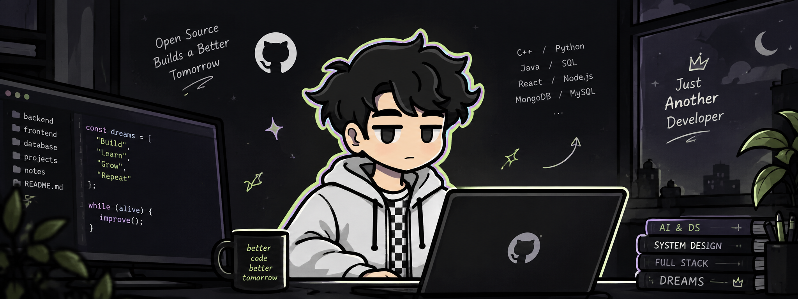

<h1>Hitarth Saparia</h1>

<b>FULL STACK DEVELOPER &nbsp;•&nbsp; AI / DATA SCIENCE</b>

<i>Building intelligent products, from interface to model.</i>

 

  

📍 Pune, India &nbsp;·&nbsp; 🟢 Open to full-time & freelance roles

 

## `01` &nbsp;About

<table>
<tr>
<td width="280" align="center" valign="middle">

 <i>better code, better tomorrow :)</i>
</td>
<td valign="top">

I'm a software engineering student in **Pune** who likes building products end to end: a clean interface, a dependable API behind it, and a machine learning model when the problem actually calls for one.

| | |
|:--|:--|
| **Role** | Full Stack Developer · AI / Data Science |
| **Based in** | Pune, India · open to remote & relocation |
| **Studying** | B.Tech AI & DS · MMCOE, Pune · Class of 2028 |
| **Fellowship** | TIH-IoT CHANAKYA Fellow |
| **Seeking** | Summer 2027 internships · ML, full-stack & agentic systems |

</td>
</tr>
</table>

 

## `02` &nbsp;Selected Work

<table>
<tr>
<td width="50%" valign="top">

### ⚖️ LLM-as-a-Judge Eval System
`AGENTIC AI`

Six judge agents score every LLM answer on accuracy, relevance, reasoning, hallucination, safety and style. An Advisor Agent then recommends the best model for a task from past eval data.

`Python` `LangGraph` `FastAPI` `Ollama` `MongoDB`

</td>
<td width="50%" valign="top">

### 🤖 Multi-Agent SDE Platform
`AGENTIC AI`

Product, Architect, Builder, QA, Reviewer and Release agents in one LangGraph pipeline, with human approval gates and a kanban plus diff-viewer dashboard.

`LangGraph JS` `Node` `React` `Postgres` `Prisma`

</td>
</tr>
<tr>
<td width="50%" valign="top">

### 🩺 MediGuard AI
`HEALTHTECH` · *IEEE CodeBhoomi 2026*

Multi-role healthcare platform for patients, doctors, admins and pharmacies, with AI clinical support, teleconsultation and emergency dispatch.

`Flask` `MySQL` `JavaScript` `Zoom SDK`

</td>
<td width="50%" valign="top">

### 🌱 Crop Disease Detection
`EDGE AI` · *CHANAKYA Fellowship*

Strawberry and guava disease classifier. MobileNetV3 compressed with TFLite quantization to run fully on-device.

`TensorFlow` `MobileNetV3` `TFLite`

</td>
</tr>
<tr>
<td colspan="2" valign="top">

### 🤝 Sahakar Saathi
`SIH 2026` · *Team VikasITech*

Cooperative gov-services portal for household and community work, with citizen, labour cooperative, worker and ministry admin views.

`React` `Vite` `Firebase`

</td>
</tr>
</table>

 

## `03` &nbsp;Toolbox

 

## `04` &nbsp;By The Numbers

 

## `05` &nbsp;Right Now

| | |
|:--|:--|
| 🔨 **Building** | Agentic pipelines with human-in-the-loop control |
| 🚢 **Shipping** | LLM-Judge frontend wired to its live backend |
| 🔬 **Exploring** | Edge-AI models that run smaller and faster |
| 🎯 **Aiming at** | Summer 2027 internships |

 

